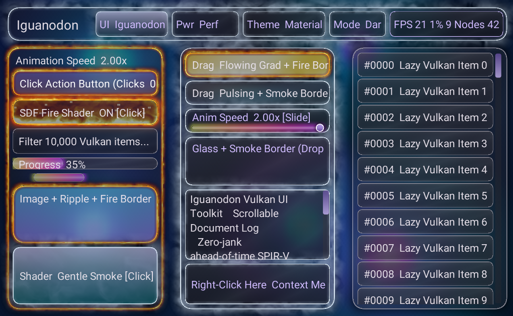

# 🦖 Iguanodon (`v0.0.1-alpha`)

**High-Performance Rust Vulkan 1.3 SDF UI Engine & Pure `androidx.compose.runtime` Toolkit for Linux Desktop and Android**

[](./LICENSE)
[](https://github.com/emilieroberts/iguanodon)
[](https://github.com/emilieroberts/iguanodon)

> [!WARNING]
> **Experimental Alpha Software (`v0.0.1-alpha`) — Do Not Use in Production**
>
> **Iguanodon is an experimental `0.0.1-alpha` research prototype and should NOT be used in production code.** APIs, binary opcodes, layout behavior, and rendering backends are under active exploration and may change or break without notice.
>
> **Transparency Note:** This library, its Vulkan SDF shader pipeline, its pure `androidx.compose.runtime` Applier bridge, and its bundled AI porting skills were **built with Google Gemini 4**.



---

## Overview

**Iguanodon** ([`github.com/emilieroberts/iguanodon`](https://github.com/emilieroberts/iguanodon)) is an experimental cross-platform UI toolkit that pairs a **Rust Vulkan 1.3 Signed-Distance-Field (SDF) rendering engine** (`libiguanodon_ffi.so`) with a **pure `androidx.compose.runtime` Kotlin Multiplatform frontend** (`:iguanodon-compose`).

Unlike standard Compose Multiplatform — which pulls in `compose-ui`, `compose-foundation`, `compose-material3`, and Skia/Skiko (`LayoutNode` + Canvas) — **`:iguanodon-compose` depends only on `androidx.compose.runtime`** (`Recomposer` + `BroadcastFrameClock` + `Composition` + a custom [`IguanodonApplier`](./kotlin/iguanodon-compose/src/commonMain/kotlin/iguanodon/compose/IguanodonApplier.kt)):

1. **Zero `compose-ui` / Skia Dependency**: `@Composable` functions emit retained `IguanodonNode` mutations via `ComposeNode<IguanodonNode, IguanodonApplier>` directly into a batched binary command buffer (`opcodes 0x10..0x1A`).
2. **Single-Call Binary FFI & Reverse Event Polling**: Every frame flushes tree mutations to Rust (`iguanodon_flush_commands`) in a single call and drains 32-byte `ReverseUiEvent` records (`iguanodon_engine_poll_events`) back to Kotlin click, scroll, drag, hover, and keyboard handlers.
3. **4 Expressive Themes × Dark & Light Modes**:
   - **Material 3 Expressive** (Dark & Light)
   - **Windows Fluent 2** (Dark & Light)
   - **iOS Liquid Glass** (Dark & Light)
   - **Linux Elite Obsidian** (Dark & Light)
4. **Built-In Procedural Shaders & Physics**:
   - **Volumetric Fire (`0x0A`)** & **`Modifier.fireBorder(...)`**
   - **Gentle Smoke** & **`Modifier.smokeBorder(...)`**
   - **Gentle Pulsing Lights**, **Reflective Glass**, **Color-Cycling Glowbar**, and **Flowing Gentle Gradient**
   - **Jello Click Wobble** & **Overspring List Scroll Physics**
   - **Global Animation Speed Multiplier (`0.0x`–`2.5x`)**
5. **Multi-Toolkit Porting Compatibility**: Built-in `@Composable` compatibility layers and AI porting skills for **Jetpack Compose / Compose Multiplatform (Navigation 3)**, **Qt 5 / Qt 6 (`QWidgets` & `QML`)**, and **GTK 3 / GTK 4 / Libadwaita**.

---

## Repository Directory Structure

```text
iguanodon/
├── crates/                         # Rust Workspace Crates (#![forbid(unsafe_code)] except FFI/VK/X11)
│   ├── iguanodon-core/             # Geometry, expressive spring physics, UTF-8 text edit & telemetry
│   ├── iguanodon-theme/            # 4 theme families × Dark & Light palettes + smooth interpolation
│   ├── iguanodon-layout/           # Flexbox layout solver & 10,000-item O(visible) list virtualizer
│   ├── iguanodon-text/             # Embedded TrueType Roboto font rasterizer & multiline glyph layout
│   ├── iguanodon-shaders/          # SPIR-V shader modules, 8 procedural materials & WGSL validator
│   ├── iguanodon-vk/               # Vulkan 1.3 dynamic loader & tile-parallel SDF raster pipeline
│   ├── iguanodon-widgets/          # Retained ApplierSceneGraph, ReverseUiEvent queue & widget catalog
│   ├── iguanodon-ffi/              # C-ABI & JNI bridge (libiguanodon_ffi.so / .a)
│   └── iguanodon-platform/         # Native Linux X11/Vulkan host & benchmark binary
├── kotlin/                         # Pure-Runtime Kotlin Multiplatform Workspace (Android & Desktop JVM)
│   ├── iguanodon-compose/          # Pure compose.runtime library (IguanodonApplier, Widgets, Nav3, Compat)
│   ├── desktop-benchmark-app/      # Desktop JVM benchmark sample app entrypoint
│   └── android-benchmark-app/      # Android Edge-to-Edge Activity + Vulkan SurfaceView sample app
├── skills/                         # Easy-to-find AI Porting Skills (mirrored in .agents/skills/)
│   ├── compose-to-iguanodon/       # Jetpack Compose & Compose Multiplatform (Navigation 3) porting skill
│   ├── qt-to-iguanodon/            # Qt 5 / Qt 6 (QWidgets .ui & QML) porting skill
│   └── gtk-to-iguanodon/           # GTK 3 / GTK 4 & GNOME Libadwaita porting skill
├── dist/                           # Pre-packaged distributables (.aar, .jar, iguanodon.h, CMake, pkg-config)
├── scripts/                        # Build, packaging, import migration & Android ADB deployment scripts
│   ├── package_dist.sh             # Rebuilds dist/ (.so, .a, .jar, .aar, iguanodon.h, .pc, .cmake)
│   ├── run_android_phone.sh        # Cross-compiles arm64-v8a & deploys the demo APK over ADB
│   └── migrate_compose_imports.sh  # Rewrites androidx.compose.{ui,foundation,material3} -> iguanodon.compose
├── tools/token-sync/               # Rust -> Kotlin theme/token code generator
├── LICENSE                         # Apache License 2.0 (Copyright 2026 Emilie Roberts)
├── NOTICE                          # Attribution & Apache 2.0 Notice
└── SECURITY.md                     # Security audit summary & vulnerability reporting policy
```

---

## Building & Running the Test / Benchmark Applications

### Prerequisites
- **Rust**: `rustup` stable toolchain (`cargo`, `rustc` 1.75+)
- **JDK**: JDK 17 or 21+ (for Kotlin Multiplatform Desktop & Android builds)
- **Linux Desktop**: X11 (`libX11.so.6`) and Vulkan loader (`libvulkan.so.1`)
- **Android (Optional)**: Android SDK (`minSdk 26`, `compileSdk 35`), Android NDK (`aarch64-linux-android`), and `adb`

### 1. Run All Rust & Kotlin Unit Tests
```bash
# Run all 38 Rust workspace unit tests (core, layout, shaders, vk, widgets, ffi, platform)
cargo test --workspace

# Build release libiguanodon_ffi.so and run the pure-runtime IguanodonApplier Kotlin desktop test
cargo build --release -p iguanodon-ffi
cd kotlin && ./gradlew :iguanodon-compose:desktopTest
```

### 2. Run the Native Linux Desktop Test / Benchmark App
```bash
cargo run --release -p iguanodon-platform --bin benchmark_app
```
This opens the hardware-accelerated **Iguanodon Vulkan UI Toolkit** window on Linux Desktop featuring:
- **Live Renderer Toggle (`UI: Iguanodon` vs `UI: Compose-UI`)**: Defaults to **`Iguanodon`** (superellipse squircle/chamfer SDF geometry, procedural shaders, 1080p Water Drop wallpaper, and volumetric borders) and toggles live to **`Compose-UI`** (standard circular-arc `p = 2.0` rounded corners and flat Material 3 surfaces) for instant side-by-side comparison.
- **Performance vs Power-Saving Mode (`Pwr: Perf 120` vs `Pwr: Eco 30`)**: Defaults to **`Performance` (`120 FPS`)** and toggles live to **`Power-Saving` (`30 FPS`)**, which throttles frame pacing (`33.3 ms` frame interval on X11, Desktop Swing, and Android `Choreographer`), suppresses exterior `16..32px` FBM Fire/Smoke border overdraw halos, switches continuous water-ripple textures to static sampling, and scales background shader clock progression by `0.35x` to save battery.
- Interactive theme switcher across all **4 themes** (`Material 3 Expressive`, `Fluent 2`, `Liquid Glass`, `Linux Elite Obsidian`) and **Dark / Light** polarity toggle
- **8 Shader Materials** (`Fire`, `Gentle Smoke`, `Pulsing Lights`, `Reflective Glass`, `Glowbar`, `Flowing Gradient`, `Jello Click Wobble`, `Overspring Scroll`) + **Smoke & Fire Card Borders**
- Interactive **Animation Speed Slider (`0.0x`–`2.0x`)**
- **10,000-Item Virtualized `LazyColumn`** with draggable scrollbar and overspring bounce
- **1080p Water Drop Procedural Wallpaper** with aspect-preserving linear cover scaling & center crop

### 3. Run the Android Test App on a Connected Phone via ADB
Connect an Android phone (`arm64-v8a`, Android 8.0+) with USB Debugging enabled and run:
```bash
./scripts/run_android_phone.sh
```
The script automatically cross-compiles `libiguanodon_ffi.so` for `aarch64-linux-android` (with 16 KB ELF page alignment for Android 15+), packages and signs the APK, installs it via `adb`, and launches `IguanodonBenchmarkActivity` with full **Android Edge-to-Edge** rendering and **Portrait (single-column) / Landscape (3-column)** rotation support.

---

## Using Iguanodon in Your Projects

### Option 1: Recommended Dual-Renderer Build Model (`-Piguanodon.renderer=iguanodon|compose-ui`)
When porting a Jetpack Compose or Compose Multiplatform application, you can configure **build-time renderer selection** so 100% of your business logic, `ViewModel`s, repositories, and `@Composable` screens stay clean while allowing side-by-side comparison between **Iguanodon** and stock **`compose-ui`**:

1. In `gradle.properties`:
   ```properties
   iguanodon.renderer=iguanodon
   ```
2. In your module's `build.gradle.kts`:
   ```kotlin
   val uiRenderer = providers.gradleProperty("iguanodon.renderer")
       .orElse("iguanodon")
       .get()
       .lowercase()
   val useIguanodonRenderer = (uiRenderer != "compose-ui")

   kotlin {
       androidTarget()
       jvm("desktop")

       sourceSets {
           val commonMain by getting {
               kotlin.srcDir(
                   if (useIguanodonRenderer) "src/rendererIguanodonMain/kotlin"
                   else "src/rendererComposeUiMain/kotlin"
               )
               dependencies {
                   implementation(compose.runtime)
                   implementation(libs.kotlinx.coroutines.core)
                   implementation(libs.kotlinx.serialization.json)

                   if (useIguanodonRenderer) {
                       implementation(project(":iguanodon-compose"))
                   } else {
                       implementation(compose.ui)
                       implementation(compose.foundation)
                       implementation(compose.material3)
                   }
               }
           }
       }
   }
   ```
3. Build or run with either renderer on demand:
   ```bash
   ./gradlew runDesktop -Piguanodon.renderer=iguanodon
   ./gradlew runDesktop -Piguanodon.renderer=compose-ui
   ```

### Option 2: Pre-Packaged Distributable Libraries (`dist/`)
Run `./scripts/package_dist.sh` to generate self-contained single-file artifacts in [`dist/`](./dist):
- **Android AAR**: [`dist/iguanodon-compose-android-0.0.1-alpha.aar`](./dist/iguanodon-compose-android-0.0.1-alpha.aar) — drop into `app/libs/` and add `implementation(files("libs/iguanodon-compose-android-0.0.1-alpha.aar"))`.
- **Linux Desktop Fat JAR**: [`dist/iguanodon-compose-desktop-linux-x64-0.0.1-alpha.jar`](./dist/iguanodon-compose-desktop-linux-x64-0.0.1-alpha.jar) — bundles all `:iguanodon-compose` classes plus embedded `libiguanodon_ffi.so`.
- **C / C++ / Qt / GTK Native FFI**:
  - Header: [`dist/include/iguanodon.h`](./dist/include/iguanodon.h)
  - CMake config: [`dist/cmake/IguanodonConfig.cmake`](./dist/cmake/IguanodonConfig.cmake) (`find_package(Iguanodon REQUIRED)` $\rightarrow$ `Iguanodon::iguanodon_ffi`)
  - `pkg-config`: [`dist/pkgconfig/iguanodon.pc`](./dist/pkgconfig/iguanodon.pc)

---

## Bundled AI Porting Skills (`skills/` & `.agents/skills/`)

Iguanodon includes three version-1 AI coding skills in [`skills/`](./skills/README.md) (and mirrored in [`.agents/skills/`](./.agents/skills/README.md) for automatic discovery by AI IDEs and agents):

1. **[`compose-to-iguanodon`](./skills/compose-to-iguanodon/SKILL.md)** — Port Jetpack Compose & Compose Multiplatform apps (including **Navigation 3** `NavDisplay` / `rememberNavBackStack`, 3-tier `NavigationSuiteScaffold`, `ScrollableNavigationBar`, `ScrollableChipRow`, and `HorizontalSplitPane` / `VerticalSplitPane`) to Iguanodon on Linux and Android.
2. **[`qt-to-iguanodon`](./skills/qt-to-iguanodon/SKILL.md)** — Port Qt 5 / Qt 6 applications (`QWidgets` `.ui` XML, C++ signals/slots, and Qt Quick `.qml`) to Iguanodon.
3. **[`gtk-to-iguanodon`](./skills/gtk-to-iguanodon/SKILL.md)** — Port GTK 3, GTK 4, and GNOME Libadwaita applications (`GtkBuilder` `.ui` XML, Blueprint `.blp`, C/Rust/Python) to Iguanodon.

---

## Security Audit Summary

Before public release, the codebase was audited for memory safety, FFI boundary validation, shader sandboxing, and credential/path hygiene. See [`SECURITY.md`](./SECURITY.md) for full details:
- **`#![forbid(unsafe_code)]`** enforced across `iguanodon-core`, `iguanodon-theme`, `iguanodon-layout`, `iguanodon-text`, `iguanodon-shaders`, `iguanodon-widgets`, `benchmark_app`, and `token-sync`.
- **Checked Arithmetic & Allocation Caps Across FFI/JNI (`iguanodon-ffi`)**: All binary command decoders (`read_u16`, `read_u32`, `read_u64`, `read_f32`, `read_str`, `SetImageBytes`) use overflow-checked cursor arithmetic (`checked_add`), framebuffer allocations are clamped to `MAX_FRAMEBUFFER_DIM = 8192` with `checked_mul`, and JNI batch buffers are bounded by `MAX_FFI_BATCH_BYTES = 64 MiB`.
- **WGSL Custom Shader Sandboxing (`iguanodon-shaders`)**: Rejects shaders exceeding 16 KiB, unbounded loops (`loop {}`, `while(true)`), and forbidden pointer/assembly constructs.
- **Native Library Extraction Hardening (`IguanodonNativeBridge.kt`)**: Enforces owner-only permissions (`0700`) on extracted temporary `.so` files prior to writing and loading.

---

## License

Copyright 2026 Emilie Roberts.

Licensed under the **Apache License, Version 2.0** (the "License"); you may not use this project except in compliance with the License. See [`LICENSE`](./LICENSE) and [`NOTICE`](./NOTICE) for details.
